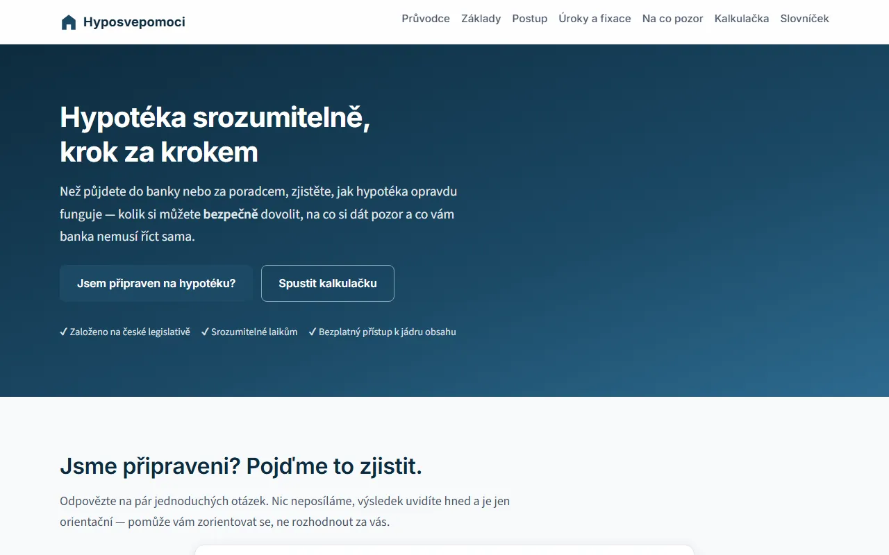
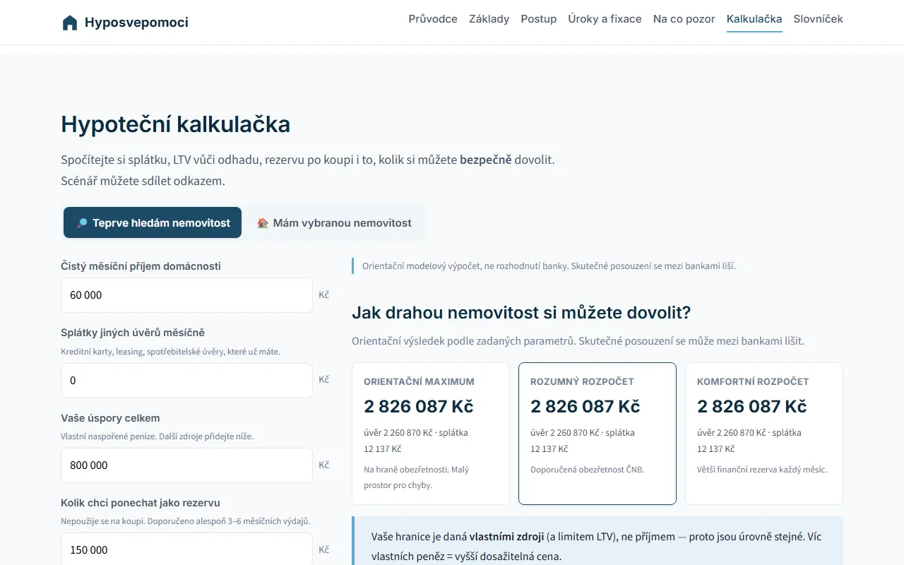

# Hyposvepomoci

Interaktivní hypoteční průvodce pro laickou veřejnost (ČR). Provede člověka hypotékou od prvního rozhodnutí až po podpis smlouvy — kalkulačka, stres test, fixace, poplatky a hlavně **kolik si můžete bezpečně dovolit**. Obsah vychází z aktuální české legislativy (stav k 5. 9. 2026).

> ⚠️ Web slouží pouze ke vzdělávacím účelům a nepředstavuje finanční, právní ani daňové poradenství.

**▶ Živé demo: [hyposvepomoci.vercel.app](https://hyposvepomoci.vercel.app)**

| Úvod | Kalkulačka | Mobil |
|---|---|---|
|  |  |  |

## Co umí

- **Průvodce „Jsem připraven na hypotéku?“** — pár otázek a orientační výsledek, bez odesílání dat.
- **Kalkulačka** — splátka, LTV vůči odhadu, rezerva po koupi, stres test a tři úrovně rozpočtu (maximum / rozumný / komfortní). Scénář jde sdílet odkazem.
- **Daňový odpočet** podle roku obstarání, **rozhodovací strom předčasného splacení**, **překladač bankovní nabídky**, checklisty před podpisem a otázky na bankéře, slovníček.
- **Štítky váhy informace** u každého tvrzení: 🟢 ZÁKON / 🔵 DOPORUČENÍ / 🟣 PRAKTICKÁ RADA.
- **Datová vrstva:** všechna regulatorní čísla jsou v `data/*.json` se zdrojem a datem ověření, v HTML nic natvrdo.
- **Prémiové nástroje** jsou zatím jen UX demo (zamčené karty). Prémiový obsah v repu není.

## Stack

HTML + CSS + vanilla JavaScript bez buildu · JSON datová vrstva · Chart.js (lazy-load, s textovým fallbackem) · testy v čistém Node.js · Vercel (statický hosting)

## Spuštění

Web čte `data/*.json` přes `fetch`, takže musí běžet přes HTTP server (ne z `file://`):

```bash
python3 -m http.server 8000
# → http://localhost:8000
```

Žádný build systém. Nasazení = nahrát statické soubory (GitHub Pages, Netlify, Vercel).

## Testy

Matematické jádro kalkulačky má testy (bez frameworku):

```bash
node js/calculator-core.test.js
```

## Struktura

```
index.html            Jedna stránka, všechny sekce
css/                  main, sections, calculator, paywall, print
js/
  data-layer.js       Načte data/*.json, plní .fact prvky, štítky ZÁKON/DOPORUČENÍ/RADA
  readiness-guide.js  Průvodce „Jsem připraven na hypotéku?“
  calculator-core.js  Čistá matematika (+ testy calculator-core.test.js)
  calculator-ui.js    UI kalkulačky, LTV vůči odhadu, A/B/C, rezerva, stres test
  charts.js           Grafy (lazy-load Chart.js, textový fallback), amort tabulka, CSV
  tax-calculator.js   Daňový odpočet dle roku obstarání
  early-repayment.js  Rozhodovací strom předčasného splacení
  offer-translator.js Překladač bankovní nabídky
  checklists.js       Checklist před podpisem + otázky na bankéře
  content.js          Příklad rodiny, red flags, FAQ „Co se stane, když…“
  paywall.js          Prémiové karty (POUZE demo, ne bezpečnostní ochrana)
data/                 regulatory, tax, early-repayment, sfpi, glossary, banks
assets/               favicon.svg, og-image.svg
PLAN.md               Kompletní plán projektu
CLAUDE.md             Konvence a kritická pravidla
```

## Kritická pravidla

1. Žádná regulatorní/číselná hodnota natvrdo v HTML — vše přes datovou vrstvu (`data/*.json`) se zdrojem a datem ověření.
2. Klientský paywall je pouze UX demo, ne bezpečnostní ochrana; prémiový obsah se do klienta neposílá.
3. „Závazný limit“ jen tam, kde to zdroj potvrzuje (2026: LTV závazný; DTI/DSTI doporučení).
4. Kalkulačka je orientační — vždy s upozorněním, že se skutečný kalendář banky může lišit.

## Ověřování dat

Před publikací a periodicky ověřovat všechna čísla (`verifiedAt` v `data/*.json`) proti: ČNB, Finanční správa, MF ČR, ČÚZK, SFPI.

## Jak vzniklo s Claude Code

Web jsem postavil s Claude Code podle předem sepsaného plánu. Všechny commity mají Claude jako spoluautora.

- [`PLAN.md`](PLAN.md) — kompletní plán: designové principy, kritická pravidla, datový model a fáze,
- [`CLAUDE.md`](CLAUDE.md) — konvence a kritická pravidla pro Clauda (žádná čísla natvrdo, paywall jen jako demo, …),
- `js/calculator-core.test.js` — matematika kalkulačky má testy a vznikala jako první, před UI.

## Licence

[MIT](LICENSE) © 2026 Pavel Procházka
